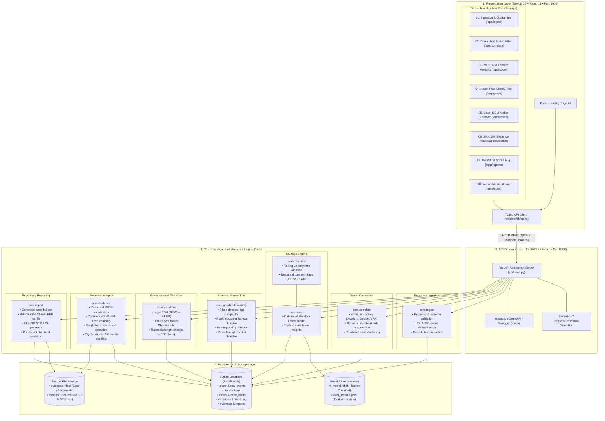
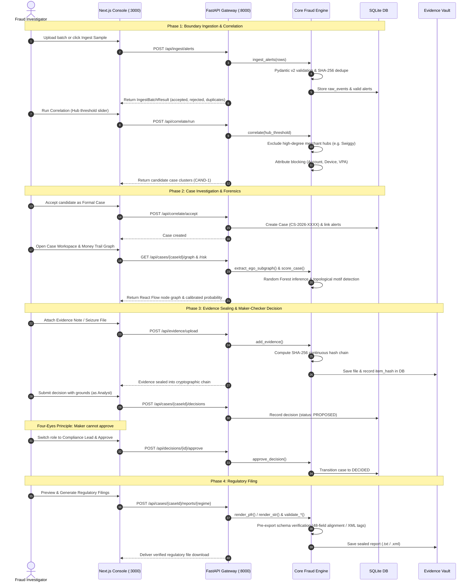
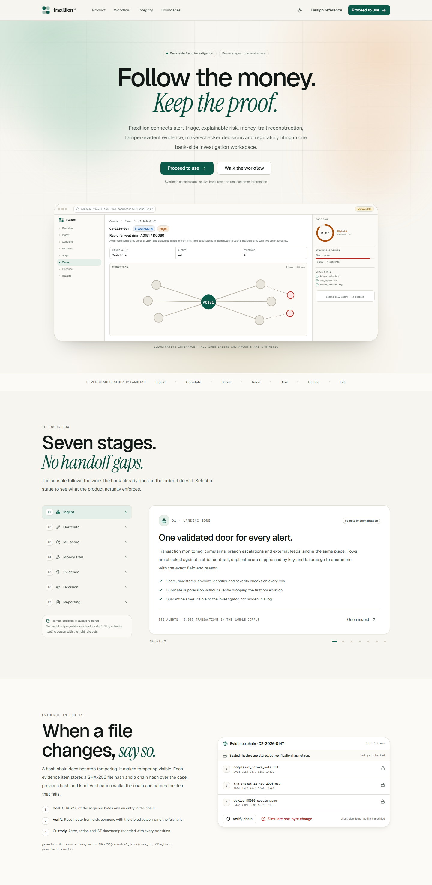
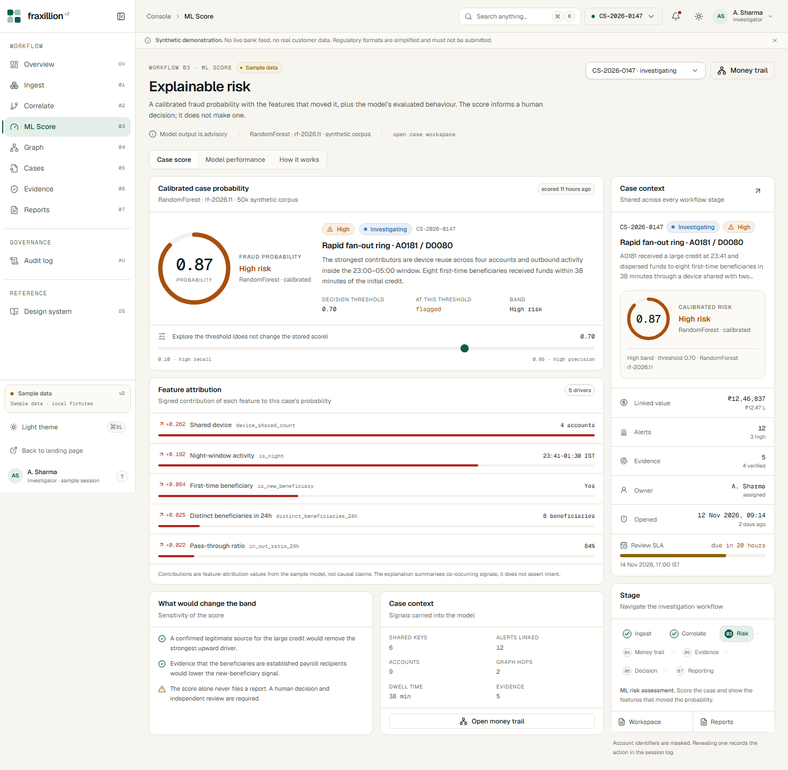
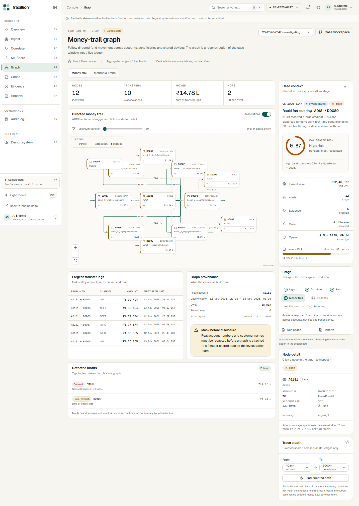

# Fraxillion — Real-Time UPI Fraud Investigation Suite

Developed by **Team Fraxillion**

<p align="left">
  <a href="https://www.python.org/"></a>
  <a href="LICENSE"></a>
  <a href="#6-running-automated-tests"></a>
  <a href="web/"></a>
  <a href="api/"></a>
  <a href="core/ml_scoring.py"></a>
  <a href="core/graph_engine.py"></a>
  <a href="core/evidence.py"></a>
  <a href="core/reporting.py"></a>
</p>

<p align="left">
  <a href="https://www.python.org/"></a>
  <a href="https://nextjs.org/"></a>
  <a href="https://react.dev/"></a>
  <a href="https://www.typescriptlang.org/"></a>
  <a href="https://tailwindcss.com/"></a>
  <a href="https://reactflow.dev/"></a>
  <a href="https://fastapi.tiangolo.com/"></a>
  <a href="https://scikit-learn.org/"></a>
  <a href="https://networkx.org/"></a>
  <a href="https://sqlite.org/"></a>
  <a href="https://pytest.org/"></a>
</p>

> ⚠️ **Academic & Demonstration Disclaimer:**  
> **This platform is a proof-of-concept prototype for academic and evaluation purposes. It is not connected to live bank switches, RBI DAKSH, or FIU-IND FINGate. All datasets, accounts, identities, and report formats are synthetic.**

---

## 1. Executive Summary

**Fraxillion** is an enterprise-grade financial fraud investigation and regulatory automation platform built for high-velocity real-time payment systems (UPI). It implements the complete end-to-end lifecycle commercial banks require to combat mule syndicates and automated digital payment fraud:

1. **Boundary Ingestion:** Ingests raw UPI payment telemetries and fraud alerts with strict Pydantic v2 schemas, quarantining malformed events with clear diagnostic errors, and enforcing idempotent SHA-256 deduplication.
2. **Graph Correlation & Hub Suppression:** Resolves entities across accounts, devices, and VPAs. Applies dynamic hub-degree thresholding to suppress legitimate high-volume merchants (e.g. Swiggy/Zomato) and cluster true mule rings into candidate cases.
3. **Machine Learning Risk Scoring:** Calculates calibrated fraud probabilities using a trained Random Forest classifier. Generates transparent feature attribution weights explaining top risk drivers.
4. **Interactive Money Trail Graph:** Maps directed payment flows in an interactive **React Flow** canvas, automatically detecting topological motifs:
   - *Rapid Nocturnal Fan-Out* (funds dispersed across 8+ beneficiaries between 11 PM and 5 AM in under 40 minutes).
   - *Fan-In Pooling* (consolidation of mule funds into exit accounts).
   - *Pass-Through Layering* (zero-balance conduit accounts with dwell time $< 180$ seconds).
5. **Case Workspace & Maker-Checker Governance:** Manages case progression across a formal Finite State Machine (`NEW` $\to$ `TRIAGE` $\to$ `INVESTIGATING` $\to$ `DECIDED` $\to$ `FILED`) and enforces strict **Four-Eyes Maker-Checker** approval controls (the maker who proposes an action cannot sign off on it).
6. **Tamper-Evident Evidence Vault:** Cryptographically links all case evidence (account statements, IP logs, seizure memos) in a continuous SHA-256 hash chain ($\text{item\_hash}_n = \text{SHA-256}(\text{item\_hash}_{n-1} + \text{file\_hash}_n + \text{metadata})$), compliant with Indian Evidence Act §65B / BSA standards, featuring one-click tamper detection and restore.
7. **Automated Regulatory Reporting:** Compiles canonical case objects into standardized **RBI DAKSH** (48-field pipe-delimited flat files) and **FIU-IND STR** (XML format) with automated pre-export validation gates.

---

---

## 2. Detailed System Architecture



### End-to-End Investigation Lifecycle Sequence



---

## 3. Technology Stack

<p align="left">
  <a href="https://nextjs.org/"></a>
  <a href="https://react.dev/"></a>
  <a href="https://www.typescriptlang.org/"></a>
  <a href="https://tailwindcss.com/"></a>
  <a href="https://reactflow.dev/"></a>
  <a href="https://www.python.org/"></a>
  <a href="https://fastapi.tiangolo.com/"></a>
  <a href="https://scikit-learn.org/"></a>
  <a href="https://networkx.org/"></a>
  <a href="https://sqlite.org/"></a>
  <a href="https://pytest.org/"></a>
</p>

| Layer | Technologies |
| :--- | :--- |
| **Frontend Framework** | Next.js 15.5 (App Router), React 19.1, TypeScript 5.9 |
| **Styling & Design** | Tailwind CSS 3.4, PostCSS, Custom Semantic Tokens (`tokens.css`), Geist Sans/Mono |
| **UI Components** | Radix UI primitives, TanStack Table v8, TanStack Virtual v3, Lucide React, Sonner |
| **Graph Visualizer** | `@xyflow/react` (React Flow 12.9) |
| **API Framework** | FastAPI 0.121, Uvicorn 0.41 (ASGI) |
| **Data & Serialization** | Pydantic v2.14, Pandas 3.1, NumPy 2.5 |
| **Machine Learning** | Scikit-Learn 1.9 (Calibrated Random Forest, Feature Attribution) |
| **Graph Algorithms** | NetworkX 3.7 (Ego subgraphs, cycle detection, topological motif detectors) |
| **Database** | SQLite 3 (`fraxillion.db`), WAL-enabled, ACID compliant |
| **Security & Hashes** | SHA-256 Continuous Chaining, Canonical JSON (`hashlib`) |
| **Testing** | Pytest 9.2 (23 automated unit tests) |

---

## 4. Quick Start Guide

### Prerequisites
* **Python 3.11+** (Python 3.11, 3.12, 3.13, 3.14 supported)
* **Node.js 18+** & **npm**
* **Git**

### Step 1: Clone Repository
```powershell
git clone https://github.com/karnika-jain/fraxillion-streamlit.git
cd fraxillion-streamlit
```

### Step 2: Set Up Python Backend
```powershell
# Create and activate virtual environment
python -m venv .venv
.venv\Scripts\activate

# Install Python dependencies
pip install -r requirements.txt

# Generate synthetic datasets and baseline database
python scripts/generate_data.py
python scripts/reset_demo.py
```

### Step 3: Run the Full Stack

#### Option A: One-Command Launcher (Windows PowerShell)
```powershell
npm run dev:all
```
*(Starts the FastAPI backend on port 8000 and the Next.js frontend on port 3000 simultaneously).*

#### Option B: Run in Separate Terminals
**Terminal 1 (FastAPI Backend):**
```powershell
npm run api
```
*(Runs on `http://localhost:8000` — interactive Swagger documentation available at `http://localhost:8000/docs`).*

**Terminal 2 (Next.js Frontend):**
```powershell
npm run dev
```
*(Runs on `http://localhost:3000`).*

Open **`http://localhost:3000`** in your browser.

---

## 5. End-to-End Evaluation Walkthrough (5-Minute Path)

1. **Public Landing Page (`/`):**
   - Inspect the Stripe-inspired visual architecture, problem vs. solution breakdown, and live platform telemetry.
   - Click **`Launch Investigation Console →`**.
2. **Boundary Ingestion (`/app/ingest`):**
   - Click **`Ingest Dirty Sample`** to test boundary enforcement.
   - Observe rejected, quarantined, and duplicate rows with diagnostic error messages.
3. **Alert Correlation (`/app/correlate`):**
   - Click **`Run Correlation`**.
   - Notice merchant hub suppression (`shop@okaxis` with 28 alerts excluded from runaway merging).
   - Click **`Accept as Formal Case`** on candidate `CAND-1` (Mule Ring `A0181`, 12 alerts, 8 beneficiaries).
4. **ML Risk Scoring (`/app/score`):**
   - Inspect the calibrated Random Forest probability score (e.g. `0.84 HIGH RISK`).
   - Use the threshold simulation slider and review feature attribution bars (`device_shared_count`, `is_night`, `new_beneficiaries`).
5. **Money Trail Graph (`/app/graph`):**
   - Explore the interactive React Flow network canvas.
   - Trace the nocturnal fan-out to 8 distinct beneficiaries in under 40 minutes.
6. **Maker-Checker Case Sign-Off (`/app/cases/[caseId]`):**
   - Move status to `INVESTIGATING`.
   - Submit a proposed decision as Maker `Analyst` with grounds of suspicion ($\ge 100$ characters).
   - Switch role to `Compliance Lead` in the top header and approve the decision $\to$ status moves to `DECIDED`.
7. **Evidence Vault & Tamper Proofing (`/app/evidence`):**
   - Click **`Verify Cryptographic Chain`** $\to$ passes in green.
   - Click **`Simulate Single-Byte Tamper`** $\to$ instant red tamper detection alert!
   - Click **`Restore Original`** $\to$ returns to green pass.
8. **Regulatory Reporting (`/app/reports`):**
   - Preview RBI DAKSH 48-field PFR flat file and FIU-IND STR XML.
   - Green validation badges indicate structural pre-export verification passed.
   - Download reports and click **`Mark as Filed`**.

---

## 6. Running Automated Tests

Run the full automated test suite:

```powershell
pytest -v
```

All **23 unit tests** execute against isolated test databases:
* `test_ingest.py`: Validation rules, negative amount rejection, idempotent deduplication.
* `test_correlate.py`: Hub suppression, attribute linking, and case creation.
* `test_features.py`: Rolling velocity features, night execution flags, pass-through ratio.
* `test_score.py`: Model risk inference, probability calibration, and feature attribution.
* `test_graph.py`: Fan-out, fan-in, pass-through motif detectors, and HTML contracts.
* `test_integration.py`: Integration fallbacks for missing entities.
* `test_evidence.py`: SHA-256 continuous hash chaining, single-byte tamper detection, and ZIP bundle manifest.
* `test_workflow.py`: FSM legal transitions, rationale minimum length, and Four-Eyes Maker-Checker rule.
* `test_report.py`: PFR 48-field alignment, header count matching, and STR XML grounds validation.

To run frontend TypeScript typechecking:
```powershell
npm --prefix web run typecheck
```

---

## 7. Project Structure

```text
├── api/                  # FastAPI REST backend adapter over SQLite and core
│   ├── main.py           # 26 REST endpoints (ingest, correlate, score, graph, evidence, reports)
│   └── fixtures.json     # Typed snapshot for zero-backend fixture fallback
├── core/                 # Pure Python fraud investigation engine
│   ├── correlate.py      # Entity resolution & merchant hub suppression
│   ├── db.py             # SQLite connection & schema initialization
│   ├── evidence.py       # SHA-256 continuous hash chaining & ZIP manifest export
│   ├── features.py       # Rolling velocity & nocturnal payment flags
│   ├── graph.py          # NetworkX ego graphs & typology motif detectors
│   ├── ingest.py         # Pydantic v2 schema validation & deduplication
│   ├── report.py         # RBI DAKSH 48-field PFR & FIU-IND STR XML generators
│   ├── score.py          # Random Forest ML model inference & weights
│   ├── schema.sql        # Database schema definitions
│   └── workflow.py       # Finite State Machine & Maker-Checker rules
├── data/                 # Synthetic UPI transactions and alerts datasets
├── docs/                 # Architecture audit, design decisions, and screenshots
│   ├── AUDIT.md          # Segment-by-segment source mapping audit
│   ├── DESIGN_DECISIONS.md # Visual direction and token documentation
│   ├── GAPS.md           # Known gaps and prototype boundaries
│   └── screens/          # High-resolution UI screenshots
├── models/               # Pre-trained Random Forest model and evaluation metrics
├── scripts/              # Data generation, demo reset, and launch scripts
├── tests/                # 23 automated unit tests
├── web/                  # Next.js 15 Web Application
│   ├── src/app/          # Next.js App Router (Landing, Console, Design reference)
│   ├── src/components/   # React Flow canvas, TanStack tables, badges, dialogs
│   ├── src/lib/api.ts    # Typed API client connected to FastAPI backend
│   └── src/stores/       # Zustand UI and Maker-Checker role state
├── package.json          # Unified npm command scripts
├── requirements.txt      # Python dependencies
└── README.md             # Project documentation
```

---

## 8. Limitations & Production Roadmap

* **Synthetic Data & SQLite:** Uses synthetic UPI datasets and local SQLite for zero-setup execution. Production deployment would connect to Apache Kafka / Apache Flink for real-time switch ingestion and distributed PostgreSQL / CockroachDB.
* **Graph Scale:** Currently utilizes in-memory NetworkX graphs for 2-hop ego neighborhoods. Production roadmap includes Neo4j / Amazon Neptune for multi-billion edge subgraphs.
* **Regulatory Gateways:** Rendered reports adhere strictly to open technical standards (RBI Master Direction on Frauds & FIU-IND STR XML schema) but operate in mock mode without direct network calls to Indian government portals.

---

## 9. Visual Interface Showcase

### 🏠 1. Home / Public Landing Page (`/`)
*Public Stripe-inspired landing page introducing UPI payment fraud challenges, the 7-stage investigative architecture, and live proof telemetry metrics.*



---

### 🧠 2. Machine Learning Risk Scoring (`/app/score`)
*Calibrated Random Forest fraud probability gauge, interactive decision threshold simulation slider, and explainable feature attribution weights.*



---

### 🕸️ 3. Forensic Money Trail Graph (`/app/graph`)
*Interactive React Flow node-link canvas mapping nocturnal multi-hop mule networks, fan-out dissemination, fan-in pooling, and pass-through conduits.*



---

## 10. License

Copyright &copy; 2026 Team Fraxillion. All rights reserved.

This project is proprietary and confidential. Unauthorized copying, distribution, modification, or commercial use is strictly prohibited. See the [LICENSE](LICENSE) file for full details.
